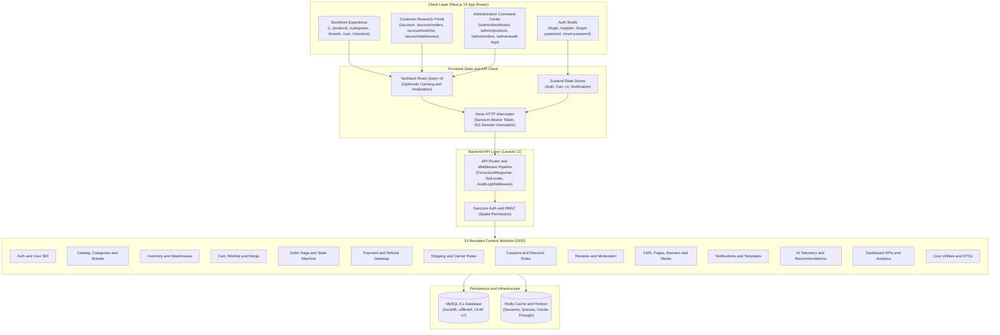

# NeuroCommerce AI

> Enterprise neuroscience, neural interface, and laboratory hardware commerce platform built with a Laravel 12 Modular Monolith and a Next.js 15 App Router frontend.


---

## 1. Project Overview

**NeuroCommerce AI** is an enterprise-grade digital commerce and laboratory telemetry acquisition platform designed specifically for neural engineering institutes, brain-computer interface (BCI) researchers, clinical laboratories, and neuroscience manufacturers.

The platform provides a comprehensive e-commerce lifecycle tailored to sensitive laboratory hardware:
- **Calibrated Product Taxonomy:** Hardware categorization supporting multi-channel EEG headsets, neural recording amplifiers, intracranial electrode arrays, and biosensing telemetry.
- **Strict Compliance & State Machines:** Order processing driven by formal finite-state machines, inventory reservation with automatic compensation on failure, and full append-only audit trail logging.
- **Modern Decoupled Architecture:** High-throughput Laravel 12 API backend structured into 14 domain-driven bounded context modules, connected to a resilient Next.js 15 (App Router) frontend.
- **Enterprise Light Design System:** Accessible, high-contrast user interfaces with unified design tokens (`#F8FAFC` page surface, `#FFFFFF` elevated cards, `#2563EB` primary brand, `#0F172A` typography, and `#E2E8F0` structural borders).

---

## 2. System Architecture

NeuroCommerce AI follows a decoupled monorepo pattern. The Next.js frontend delivers three distinct portal experiences backed by TanStack Query and Zustand, communicating with the modular Laravel 12 API via Sanctum bearer token authentication.



---

## 3. Technology Stack Matrix

### Backend Stack
| Technology / Package | Version | Purpose |
| :--- | :--- | :--- |
| **PHP** | `^8.4` | Language runtime with `declare(strict_types=1);` across all files |
| **Laravel** | `^12.0` | Core web application framework and DI container |
| **Laravel Sanctum** | `^4.0` | Stateful and token-based API authentication |
| **Spatie Laravel Permission** | `^6.0` | Role-Based Access Control (RBAC) and permission matrices |
| **Spatie Laravel Data** | `^4.0` | Strongly typed Data Transfer Objects (DTOs) |
| **Spatie Query Builder** | `^6.0|^7.0` | Dynamic API filtering, sorting, and eager loading |
| **Spatie Sluggable** | `^3.0|^4.0` | Automatic URL slug generation for products, categories, and brands |
| **Kalnoy NestedSet** | `^6.0` | Infinite-depth nested tree hierarchy for categories |
| **Owen-it Laravel Auditing** | `^14.0` | Append-only model change auditing |
| **Spatie Activitylog** | `^4.0|^5.0` | Administrative operation tracking and security event logging |
| **Laravel Scout** | `^10.0` | Full-text product search indexing |
| **Laravel Horizon** | `^5.0` | Redis queue monitoring and background job management |
| **Predis** | `^2.0|^3.0` | Redis client for multi-DB caching, sessions, and queues |
| **PHPUnit / Pest** | `^11.0` / `^3.0` | Feature and unit test automation suite |

### Frontend Stack
| Technology / Package | Version | Purpose |
| :--- | :--- | :--- |
| **Next.js** | `15.2.0` | App Router framework with SSR, SSG, and metadata management |
| **React** | `^19.0.0` | UI component rendering library |
| **TypeScript** | `^5.7.3` | Strict type safety across components, hooks, and services |
| **Tailwind CSS** | `^4.0.7` | Utility-first CSS engine with custom enterprise light-mode tokens |
| **TanStack React Query** | `^5.66.0` | Asynchronous server state management, caching, and mutations |
| **Zustand** | `^5.0.3` | Client state management for auth, shopping bag, UI, and notifications |
| **Axios** | `^1.8.1` | Promise-based HTTP client with Sanctum interceptors |
| **React Hook Form** | `^7.54.2` | Performant form state management |
| **Zod** | `^3.24.2` | Schema declaration and validation |
| **Radix UI** | `^1.1` / `^2.1` | Unstyled, accessible UI primitives (Dialog, Select, Tabs, Dropdown) |
| **Lucide React** | `^0.475.0` | Crisp, consistent icon library |
| **Framer Motion** | `^12.4.7` | Motion physics for drawer and transition animations |
| **Vitest** | `^3.0.6` | High-speed unit and integration test runner with JSDOM |

---

## 4. Monorepo Directory Structure

```
NeuroCommerce-AI/
├── architecture/                     # 9 Comprehensive Architecture Blueprints & SRS
│   ├── 00-MASTER-INSTRUCTIONS.md     # Core engineering constraints & guidelines
│   ├── 01-SRS.md                     # Software Requirements Specification
│   ├── 02-Enterprise-Architecture.md # DDD Bounded Contexts & CQRS specifications
│   ├── 03-Backend-Foundation.md      # Core classes, exception hierarchy, and contracts
│   ├── 04-REST-API-Specification.md  # Standardized REST endpoint contracts & JSON envelopes
│   ├── 05-Database-Architecture.md   # Relational schema design and indexing blueprint
│   ├── 06-Laravel-Backend-Blueprint.md # Backend engineering implementation guide
│   └── 07-NextJS-Frontend-Blueprint.md  # Next.js 15 App Router architecture & UI specifications
├── backend/                          # Laravel 12 REST API Backend
│   ├── app/
│   │   ├── Core/                     # Base repositories, services, DTOs, value objects, helpers
│   │   ├── Http/                     # Global HTTP controllers and kernel middleware
│   │   ├── Models/                   # Core shared models
│   │   ├── Modules/                  # 14 Bounded Context Domain Modules
│   │   │   ├── AI/                   # Telemetry events, recommendation models & feature store
│   │   │   ├── Admin/                # Dashboard KPIs, sales reports, feature flags, audit logs
│   │   │   ├── Auth/                 # Authentication, Sanctum tokens, customer/staff profiles
│   │   │   ├── CMS/                  # Pages, blog articles, banners, FAQs, testimonials, media
│   │   │   ├── Cart/                 # Guest/authenticated carts, items, wishlist & merge
│   │   │   ├── Catalog/              # Products, nested categories, brands, variants, attributes
│   │   │   ├── Core/                 # Country and currency lookup registries
│   │   │   ├── Coupon/               # Discount rules, coupons, usage restrictions
│   │   │   ├── Inventory/            # Warehouses, stock items, stock movement ledgers, suppliers
│   │   │   ├── Notification/         # Notification center, email/SMS template engines
│   │   │   ├── Order/                # Checkout saga, order items, state machine, invoices
│   │   │   ├── Payment/              # Transactions, mock gateway providers, refunds, webhooks
│   │   │   ├── Review/               # Customer ratings, verified purchase checks, moderation
│   │   │   └── Shipping/             # Zones, rates, shipping methods, delivery event tracking
│   │   ├── Providers/                # AppServiceProvider, EventServiceProvider, etc.
│   │   └── Shared/                   # Enums (OrderStatus, PaymentStatus), traits, middleware
│   ├── bootstrap/                    # Framework bootstrap, exception renderers, middleware groups
│   ├── config/                       # System configuration (modules.php, neurocommerce.php, etc.)
│   ├── database/                     # Migrations (56 files), factories, seeders
│   ├── docs/                         # Backend implementation reports (Phases 4-16)
│   ├── routes/                       # Central api.php router and console commands
│   ├── tests/                        # 90 PHPUnit/Pest test files (Feature & Unit)
│   └── composer.json                 # Backend dependencies, autoloading & scripts
├── frontend/                         # Next.js 15 App Router Frontend
│   ├── src/
│   │   ├── app/                      # 47 Production Routes across 4 route workspaces
│   │   │   ├── (admin)/admin/        # 24 Administrative workspaces
│   │   │   ├── (auth)/               # Login, Register, Forgot Password, Reset Password
│   │   │   ├── (portal)/account/     # 8 Customer portal account pages
│   │   │   └── (store)/              # 11 Public storefront discovery & checkout routes
│   │   ├── components/               # Reusable UI component library, ConfirmDialog, EmptyState
│   │   ├── hooks/                    # 16 Custom TanStack Query data hooks
│   │   ├── lib/                      # Axios client, notifications, formatters, utilities
│   │   ├── providers/                # React Query client provider & global context providers
│   │   ├── services/                 # 19 Strongly-typed API client services
│   │   ├── stores/                   # 4 Zustand global state stores
│   │   ├── styles/                   # Global Tailwind CSS styles and theme definitions
│   │   ├── test/                     # 86 Vitest integration & UI test files
│   │   └── types/                    # Domain TypeScript interface and type declarations
│   ├── package.json                  # Frontend scripts and dependency matrix
│   ├── tsconfig.json                 # TypeScript strict configuration
│   └── vitest.config.ts              # Vitest test runner configuration
├── docs/                             # Frontend engineering reports (Phase 24)
├── prompts/                          # System specifications & historical implementation logs
├── CHANGELOG.md                      # Release log
└── README.md                         # Root repository documentation
```

---

## 5. Core Platform Capabilities

### Storefront Experience
- **Executive Laboratory Homepage (`/`):** Features hero hardware banners, product discovery carousels, trusted neuroscience manufacturers, value propositions, telemetry insights, and AI recommendations.
- **Product Catalog (`/products`):** Faceted filtering by nested category, manufacturer brand, price range slider, in-stock availability toggle, and sorting (Newest, Price Low-to-High, Price High-to-Low, Popularity).
- **Product Detail Workspace (`/products/[slug]`):** Image gallery with full preview, SKU identification, stock availability badges, technical spec sheets, variant selectors, verified customer reviews, and related hardware recommendations.
- **Category Discovery (`/categories` & `/category/[slug]`):** Visual card grid representing hierarchical neuroscience disciplines (EEG, Intracranial Arrays, Biopotential Telemetry) with subcategory navigation.
- **Brand Directory (`/brands` & `/brand/[slug]`):** Alphabetical and search-driven manufacturer index showcasing partner certifications and brand-scoped hardware catalogs.
- **Shopping Bag (`/cart`):** 8-column line item table with thumbnail, stock level badge, 44px+ quantity controls, destructive removal confirmation dialogs, promo code voucher application, and sticky 4-column Order Summary.
- **Multi-Step Checkout (`/checkout`):** 4-stage stepper (Contact Info, Laboratory Delivery Address, Logistics Method, Payment Authorization) with authenticated address autofill, guest fallback, and duplicate-submission protection.
- **Order Confirmation (`/checkout/success`):** Receipt view displaying order tracking number, shipment timeline breakdown, itemized financials, and printable invoice.

### Customer Portal (`/account`)
- **Dashboard Overview (`/account`):** Quick-glance metrics showing active orders, saved items, default address, and recent fulfillment status.
- **Order Management (`/account/orders` & `/account/orders/[id]`):** Searchable and filterable order history with real-time delivery milestone tracking, courier tracking numbers, and line-item breakdowns.
- **Saved Hardware Wishlist (`/account/wishlist`):** Saved telemetry devices with instantaneous 'Move to Shopping Bag' action and live stock checks.
- **Address Book (`/account/addresses`):** CRUD interface for laboratory delivery docks and billing addresses with default address designation.
- **Notification Preferences (`/account/notifications`):** Communication center with unread message badges and transactional email preference toggles.
- **Customer Reviews (`/account/reviews`):** History of submitted product ratings with verified purchase status badges.

### Administrative Command Center (`/admin`)
- **Executive Dashboard (`/admin/dashboard`):** Telemetry dashboard displaying real-time revenue curves, sales metrics, conversion rates, and ranked top-selling hardware.
- **Product Management (`/admin/products`):** Full inventory CRUD, rich-text technical specifications, variant matrix generator, and image gallery manager.
- **Taxonomy & Manufacturer Control (`/admin/categories`, `/admin/brands`):** Nested category hierarchy tree editor and brand registry with logo asset management.
- **Order Fulfillment (`/admin/orders` & `/admin/orders/[id]`):** State machine lifecycle management (`pending` → `processing` → `shipped` → `delivered` → `cancelled`), staff note audit logging, and refund issuance.
- **Customer 360 (`/admin/customers` & `/admin/customers/[id]`):** Customer profile view, lifetime value metrics, order history, and account activation/deactivation.
- **Staff & RBAC Matrix (`/admin/staff`, `/admin/roles`):** Administrator user provisioning and granular permission assignment across all platform modules.
- **Promotions & Discount Rules (`/admin/coupons`):** Percentage, fixed amount, and free shipping discount rules with minimum spend constraints and category restrictions.
- **Review Moderation Queue (`/admin/reviews`):** Pending review queue with approval, rejection, featured toggle, and official staff responses.
- **Content Management System (`/admin/cms/pages`, `/admin/cms/blog`):** Static content publisher, FAQ editor, banner slider manager, and knowledge blog engine.
- **Media Asset Library (`/admin/media`):** Centralized asset vault with multi-file upload, MIME-type validation, image preview, and clipboard asset URL copying.
- **System Settings & Feature Flags (`/admin/settings`, `/admin/feature-flags`):** Dynamic runtime settings grouped by domain, with percentage-based feature flag rollout controls.
- **Audit Trails & Security Governance (`/admin/audit-logs`, `/admin/activity-logs`):** Append-only audit log with IP address capture, user agent recording, and before/after diff visualizer.
- **Real-Time System Health (`/admin/system-health`):** Live operational telemetry monitoring database query latency, Redis cache connectivity, queue backlog, and storage utilization.

---

## 6. Authentication & Security Architecture

### 1. Token Authentication
- Stateful and stateless authentication managed via **Laravel Sanctum**.
- Tokens are transmitted via the standard `Authorization: Bearer <token>` HTTP header.
- Axios request interceptors automatically attach active tokens from the persistent Zustand `auth-store`.
- Guest checkout uses anonymous session identification (`X-Session-Id`), which atomically merges into the authenticated user account upon sign-in.

### 2. Session Expiration Interceptor
- A global Axios response interceptor captures 401 Unauthorized responses from expired Sanctum tokens.
- Displays a non-intrusive `SessionExpirationDialog` prompting re-authentication without losing cart state or page context.

### 3. Role-Based Access Control (RBAC)
- Five distinct system roles enforced via **Spatie Laravel Permission**:
  1. `super-admin`: Full platform access, audit trail inspection, system settings, and role management.
  2. `admin`: General management of products, orders, customers, reviews, and CMS content.
  3. `manager`: Warehouse management, stock adjustments, and order fulfillment.
  4. `support`: Customer service inquiries, order lookup, and review moderation.
  5. `customer`: Storefront ordering, address management, and customer portal self-service.
- Protected frontend routes and action buttons are gated using the semantic `<Can permission="..." role="...">` component.

---

## 7. Local Development Setup

### Prerequisites
Ensure your local environment meets the following minimum requirements:
- **PHP:** `>= 8.4` (with `pdo_mysql`, `mbstring`, `openssl`, `curl`, `redis`, `bcmath` extensions)
- **Composer:** `>= 2.7`
- **Node.js:** `>= 20.x`
- **npm:** `>= 10.x`
- **Database:** MySQL `>= 8.0` (or MariaDB `>= 10.6`)
- **Cache & Queue:** Redis `>= 7.0`

---

### Step-by-Step Installation

#### 1. Clone Repository
```bash
git clone https://github.com/your-org/NeuroCommerce-AI.git
cd NeuroCommerce-AI
```

#### 2. Backend Setup (Laravel)
```bash
cd backend

# Install PHP dependencies
composer install

# Configure environment
cp .env.example .env

# Generate application key
php artisan key:generate

# Configure your database credentials in .env, then run database migrations and seeders
php artisan migrate --seed

# Start the Laravel backend server
php artisan serve --port=8000
```

#### 3. Frontend Setup (Next.js)
```bash
cd ../frontend

# Install Node dependencies
npm install

# Start the Next.js development server
npm run dev
```

The application will be accessible at:
- **Storefront & Portals:** [http://localhost:3000](http://localhost:3000)
- **Backend API:** [http://localhost:8000/api/v1](http://localhost:8000/api/v1)
- **API Health Check:** [http://localhost:8000/api/v1/health](http://localhost:8000/api/v1/health)

---

## 8. Environment Variables Reference

### Backend Configuration (`backend/.env`)
| Variable | Description | Default / Example |
| :--- | :--- | :--- |
| `APP_NAME` | Application name | `"NeuroCommerce AI"` |
| `APP_ENV` | Application environment | `local` / `production` |
| `APP_KEY` | Base64 application encryption key | *(Generated via `php artisan key:generate`)* |
| `APP_DEBUG` | Debug mode toggle | `true` (local) / `false` (production) |
| `APP_URL` | Backend API root URL | `http://localhost:8000` |
| `FRONTEND_URL` | Allowed CORS origin for Next.js | `http://localhost:3000` |
| `DB_CONNECTION` | Database driver | `mysql` |
| `DB_HOST` | Database host address | `127.0.0.1` |
| `DB_PORT` | Database port | `3306` |
| `DB_DATABASE` | Database schema name | `neurocommerce_ai` |
| `DB_USERNAME` | Database user | `root` |
| `DB_PASSWORD` | Database password | *(Your database password)* |
| `CACHE_STORE` | Cache storage engine | `redis` |
| `QUEUE_CONNECTION` | Asynchronous queue driver | `redis` |
| `SESSION_DRIVER` | Session storage driver | `redis` |
| `REDIS_HOST` | Redis host address | `127.0.0.1` |
| `REDIS_PORT` | Redis port | `6379` |

### Frontend Configuration (`frontend/.env.local`)
| Variable | Description | Default / Example |
| :--- | :--- | :--- |
| `NEXT_PUBLIC_API_URL` | Fully qualified base URL to the backend API v1 | `http://localhost:8000/api/v1` |

---

## 9. Testing & Quality Assurance

The codebase includes comprehensive automated test suites across both backend and frontend layers.

```
================================================================================
TEST SUITE SUMMARY
================================================================================
Backend (PHPUnit / Pest):   365 passed (1,759 assertions, 0 failures)
Frontend (Vitest / RTL):     86 test files passed (458 passed, 0 failures)
TypeScript Verification:    0 errors (Strict mode)
Production Build:           47/47 static and dynamic routes compiled
================================================================================
```

### Running Backend Tests
```bash
cd backend
php artisan test
```

### Running Frontend Tests & Type Checking
```bash
cd frontend

# Run unit and integration tests
npm test

# Run TypeScript type validation
npm run type-check

# Run Next.js production build verification
npm run build
```

---

## 10. Production Deployment

### Frontend (Vercel / Node.js Host)
1. Configure `NEXT_PUBLIC_API_URL` in your deployment environment variables pointing to your production Laravel API (e.g. `https://api.yourdomain.com/api/v1`).
2. Run build script:
   ```bash
   npm run build
   npm run start
   ```

### Backend (PHP 8.4 Server / Nginx / Caddy)
1. Ensure PHP 8.4 runtime and Redis are configured.
2. Deploy backend files and run optimization commands:
   ```bash
   composer install --no-dev --optimize-autoloader
   php artisan config:cache
   php artisan route:cache
   php artisan view:cache
   php artisan migrate --force
   ```
3. Run Horizon worker daemon to process background queues:
   ```bash
   php artisan horizon
   ```

---

## 11. Architecture Documentation Index

Detailed architectural blueprints, design decisions, and domain entity relationships are maintained in the [`architecture/`](architecture/) directory:

- [**00-MASTER-INSTRUCTIONS.md**](architecture/00-MASTER-INSTRUCTIONS.md) — System boundaries and engineering conventions.
- [**01-SRS.md**](architecture/01-SRS.md) — Complete Software Requirements Specification.
- [**02-Enterprise-Architecture.md**](architecture/02-Enterprise-Architecture.md) — Domain-Driven Design (DDD) Bounded Contexts.
- [**03-Backend-Foundation.md**](architecture/03-Backend-Foundation.md) — Abstract classes, value objects, and exception hierarchy.
- [**04-REST-API-Specification.md**](architecture/04-REST-API-Specification.md) — Comprehensive API endpoint contracts and JSON schema definitions.
- [**05-Database-Architecture.md**](architecture/05-Database-Architecture.md) — Relational schema design, table indexes, and partition planning.
- [**06-Laravel-Backend-Blueprint.md**](architecture/06-Laravel-Backend-Engineering-Blueprint.md) — Backend service implementation blueprints.
- [**07-NextJS-Frontend-Blueprint.md**](architecture/07-NextJS-Frontend-Engineering-Blueprint.md) — Frontend App Router architecture and UI token hierarchy.

---

## 12. Security Policy

NeuroCommerce AI incorporates defense-in-depth security principles:
- **Zero Sensitive Data Exposure:** Credit card tokenization and sensitive customer credentials are never persisted in plain text or logged to disk.
- **Strict In-Depth Validation:** All incoming payloads are validated via Laravel FormRequests and Zod client-side schemas.
- **CSRF & Rate Limiting:** Rate limiting configured across public and administrative route endpoints via Redis rate limiters.
- **Append-Only Auditing:** Destructive administrative actions, order modifications, and inventory adjustments generate immutable audit ledger records.

---

## 13. License

The NeuroCommerce AI codebase is open-sourced software licensed under the [MIT license](LICENSE).
