# NeuroCommerce AI — Enterprise Software Architecture Document

**Document Version:** 2.0  
**Date:** 2026-07-25  
**Author:** Chief Enterprise Software Architect  
**Classification:** Internal — Architecture Reference  
**Status:** Approved for Development  

---

## Table of Contents

1. [Enterprise System Architecture](#1-enterprise-system-architecture)
2. [Layered Architecture](#2-layered-architecture)
3. [Clean Architecture](#3-clean-architecture)
4. [Modular Architecture](#4-modular-architecture)
5. [Folder Structure](#5-folder-structure)
6. [Service Layer Design](#6-service-layer-design)
7. [Repository Pattern](#7-repository-pattern)
8. [Dependency Injection Strategy](#8-dependency-injection-strategy)
9. [Event-Driven Architecture](#9-event-driven-architecture)
10. [Queue Architecture](#10-queue-architecture)
11. [Redis Strategy](#11-redis-strategy)
12. [API Gateway Design](#12-api-gateway-design)
13. [Authentication Flow](#13-authentication-flow)
14. [Authorization Flow](#14-authorization-flow)
15. [Communication Between Modules](#15-communication-between-modules)
16. [AI Integration Flow](#16-ai-integration-flow)
17. [Sequence Diagrams](#17-sequence-diagrams)
18. [Component Diagrams](#18-component-diagrams)
19. [Deployment Diagram](#19-deployment-diagram)
20. [High-Level Architecture Diagram](#20-high-level-architecture-diagram)

---

## 1. Enterprise System Architecture

### 1.1 Architecture Philosophy

NeuroCommerce AI is designed as a **domain-driven, modular monolith** with a clear upgrade path to distributed micro-services. This is the same architectural trajectory taken by Shopify (modular Rails monolith → componentised services) and is the pragmatic choice for an HND-scoped project that must demonstrate enterprise thinking without premature infrastructure complexity.

Every architectural decision is governed by four principles:

| Principle | Meaning |
|-----------|---------|
| **Modularity** | Every bounded context is a self-contained module with its own Models, Services, Repositories, Controllers, Routes, Events, and Tests. |
| **Inversion of Control** | High-level business policy never depends on low-level infrastructure. All dependencies point inward (Clean Architecture). |
| **Event Sovereignty** | Modules communicate through domain events, never by directly calling another module's internals. |
| **AI-First Data Flow** | Every user-facing interaction emits behavioural telemetry that feeds the neural-network recommendation engine in real time. |

### 1.2 System Context

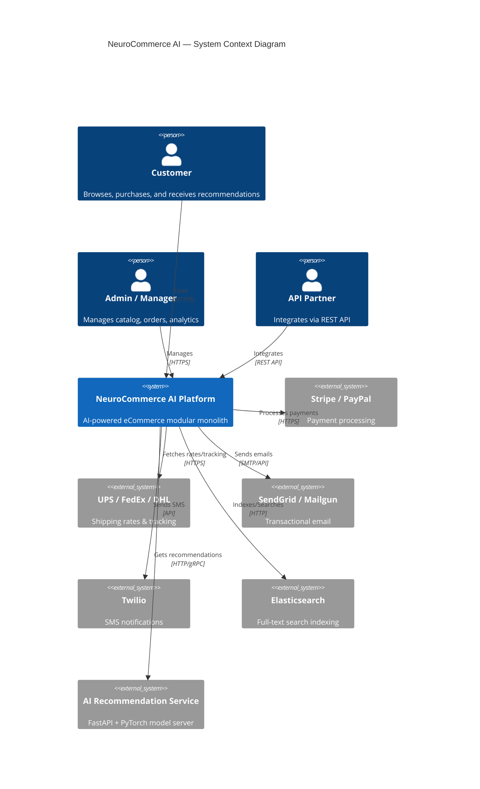

### 1.3 Why a Modular Monolith?

| Alternative | Why Not Chosen |
|-------------|----------------|
| **Pure Monolith** | No module isolation; a change to the Product module could break the Order module. Unacceptable for an enterprise-grade system. |
| **Micro-services** | Premature for a team of this size. Introduces network latency, distributed transactions, and infrastructure overhead (service mesh, API gateway, circuit breakers) before the product‑market fit is proven. |
| **Modular Monolith** ✅ | Achieves logical isolation (separate namespaces, repositories, service contracts) while deploying as a single Laravel application. Each module can be extracted into a standalone service later by converting internal event calls to HTTP/gRPC calls. This is the Shopify playbook. |

---

## 2. Layered Architecture

### 2.1 Layer Definitions

The system is organised into **five horizontal layers**, each with a strict dependency rule: a layer may only depend on the layer directly below it (or on a cross-cutting concern layer).

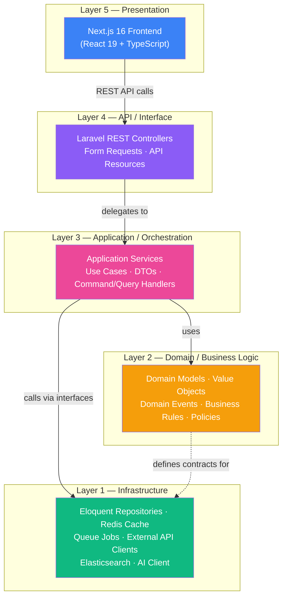

### 2.2 Layer Responsibilities

| Layer | Responsibility | Examples |
|-------|---------------|----------|
| **Presentation** | Renders UI, manages client state, calls API endpoints. | Next.js pages, Shadcn components, Zustand stores, TanStack Query hooks. |
| **API / Interface** | Accepts HTTP requests, validates input, serialises responses. | `ProductController`, `StoreProductRequest`, `ProductResource`. |
| **Application** | Orchestrates use cases by coordinating domain objects and infrastructure. Contains NO business rules. | `PlaceOrderService`, `CreateProductAction`, `GetRecommendationsQuery`. |
| **Domain** | Pure business logic. Framework-agnostic. Defines interfaces that infrastructure must implement. | `Order` aggregate, `Money` value object, `OrderPlaced` domain event, `InventoryPolicy`. |
| **Infrastructure** | Implements domain interfaces using concrete technology (Eloquent, Redis, Stripe SDK). | `EloquentProductRepository`, `RedisCartStore`, `StripePaymentGateway`. |

### 2.3 Why This Layered Approach?

* **Testability** — The Domain layer can be unit-tested with zero framework dependencies. Application services are tested with mocked repositories.
* **Replaceability** — Swapping MySQL for PostgreSQL or Stripe for Adyen affects only the Infrastructure layer.
* **Onboarding** — New developers immediately understand where to place code. Business rules go in Domain, orchestration in Application, HTTP concerns in API.

---

## 3. Clean Architecture

### 3.1 Concentric Ring Model

Clean Architecture ensures dependencies always point **inward** — from frameworks toward pure business logic.

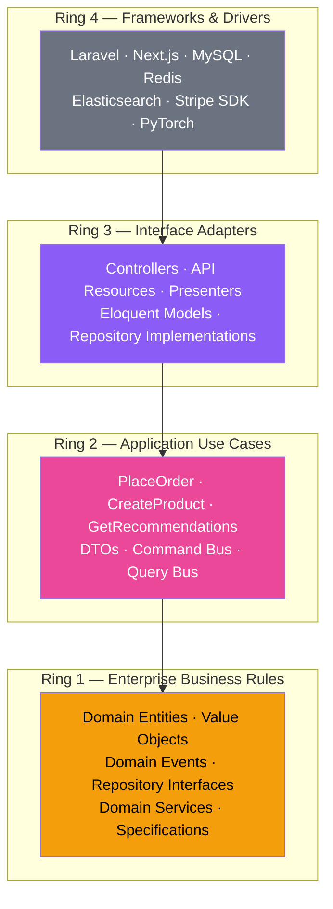

### 3.2 Dependency Rule

> **No name in an inner ring may refer to anything in an outer ring.**

This means:

* `Order` (Ring 1) defines `OrderRepositoryInterface` — it does **not** know about Eloquent.
* `PlaceOrderService` (Ring 2) depends on `OrderRepositoryInterface` — it does **not** instantiate `EloquentOrderRepository`.
* `EloquentOrderRepository` (Ring 3) **implements** the interface defined in Ring 1.
* Laravel's Service Container (Ring 4) **binds** the interface to the concrete implementation.

### 3.3 Data Crossing Boundaries

Data crosses ring boundaries via **DTOs (Data Transfer Objects)**, never via Eloquent models or raw arrays.

| Boundary | Inbound DTO | Outbound DTO |
|----------|-------------|--------------|
| Controller → Application | `CreateProductDTO` | — |
| Application → Controller | — | `ProductResponseDTO` |
| Application → Repository | `ProductFilterCriteria` | `ProductEntity` |
| Application → AI Service | `UserBehaviorDTO` | `RecommendationResultDTO` |

### 3.4 Why Clean Architecture?

* **Framework Independence** — If Laravel were deprecated, the Domain and Application layers survive intact.
* **AI Model Isolation** — The recommendation engine is behind a `RecommendationServiceInterface`. Swapping PyTorch for TensorFlow or a cloud ML API changes only the infrastructure adapter.
* **Parallel Development** — Frontend, backend API, business logic, and AI teams work on different rings without merge conflicts.

---

## 4. Modular Architecture

### 4.1 Module Inventory

Each module is a **bounded context** — a self-contained unit with its own namespace, database migrations, routes, models, services, events, and tests.

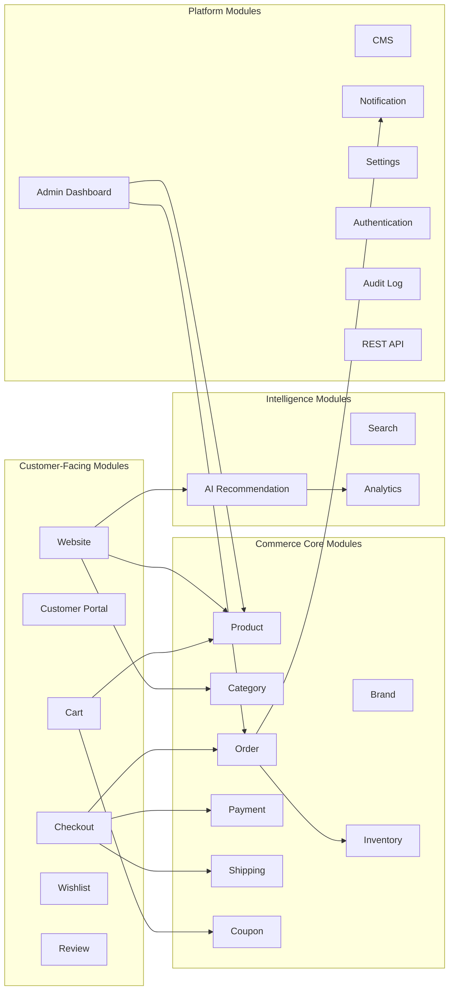

### 4.2 Module Independence Contract

Every module adheres to the following contract:

| Rule | Description |
|------|-------------|
| **Own Namespace** | `App\Modules\Product\*`, `App\Modules\Order\*`, etc. |
| **Own Service Provider** | Each module registers its own routes, bindings, event listeners, and policies. |
| **Own Migrations** | Database migrations live inside the module folder. |
| **No Cross-Module Eloquent Queries** | Module A must **never** call `Module B's` Eloquent model directly. |
| **Communication via Events or Contracts** | Modules expose **public interfaces** (contracts) and **domain events**. |
| **Own Test Suite** | Each module has independent unit/feature tests. |
| **Own Config** | Module-specific configuration in its own config file. |

### 4.3 Module Isolation Boundary

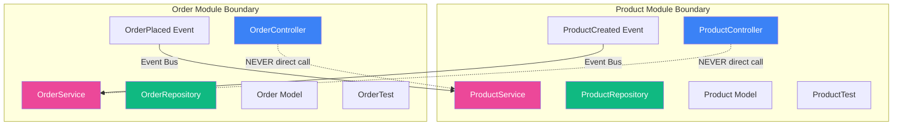

### 4.4 Why This Module Design?

* **Shopify Model** — Shopify's monolith is organised into ~100+ components, each with a well-defined public API. We replicate this at a smaller scale.
* **Independent Deployability (Future)** — Any module can be extracted into a standalone Laravel service or a separate micro-service with minimal refactoring.
* **Team Scaling** — Different developers or teams can own different modules without stepping on each other.

---

## 5. Folder Structure

### 5.1 Backend (Laravel 12)

```
backend/
├── app/
│   ├── Modules/
│   │   ├── Product/
│   │   │   ├── Config/
│   │   │   │   └── product.php
│   │   │   ├── Contracts/
│   │   │   │   ├── ProductRepositoryInterface.php
│   │   │   │   └── ProductServiceInterface.php
│   │   │   ├── Controllers/
│   │   │   │   ├── Api/
│   │   │   │   │   └── ProductController.php
│   │   │   │   └── Admin/
│   │   │   │       └── ProductAdminController.php
│   │   │   ├── DTOs/
│   │   │   │   ├── CreateProductDTO.php
│   │   │   │   ├── UpdateProductDTO.php
│   │   │   │   └── ProductResponseDTO.php
│   │   │   ├── Events/
│   │   │   │   ├── ProductCreated.php
│   │   │   │   ├── ProductUpdated.php
│   │   │   │   └── ProductDeleted.php
│   │   │   ├── Listeners/
│   │   │   │   ├── SyncProductToSearchIndex.php
│   │   │   │   └── InvalidateProductCache.php
│   │   │   ├── Jobs/
│   │   │   │   ├── BulkImportProducts.php
│   │   │   │   └── GenerateProductThumbnails.php
│   │   │   ├── Models/
│   │   │   │   ├── Product.php
│   │   │   │   ├── ProductVariant.php
│   │   │   │   └── ProductAttribute.php
│   │   │   ├── Policies/
│   │   │   │   └── ProductPolicy.php
│   │   │   ├── Providers/
│   │   │   │   └── ProductServiceProvider.php
│   │   │   ├── Repositories/
│   │   │   │   └── EloquentProductRepository.php
│   │   │   ├── Requests/
│   │   │   │   ├── StoreProductRequest.php
│   │   │   │   └── UpdateProductRequest.php
│   │   │   ├── Resources/
│   │   │   │   ├── ProductResource.php
│   │   │   │   └── ProductCollection.php
│   │   │   ├── Routes/
│   │   │   │   ├── api.php
│   │   │   │   └── admin.php
│   │   │   ├── Services/
│   │   │   │   └── ProductService.php
│   │   │   ├── Database/
│   │   │   │   ├── Migrations/
│   │   │   │   ├── Factories/
│   │   │   │   └── Seeders/
│   │   │   └── Tests/
│   │   │       ├── Unit/
│   │   │       └── Feature/
│   │   │
│   │   ├── Category/
│   │   │   └── ... (same structure)
│   │   ├── Brand/
│   │   │   └── ... (same structure)
│   │   ├── Inventory/
│   │   │   └── ... (same structure)
│   │   ├── Order/
│   │   │   └── ... (same structure)
│   │   ├── Cart/
│   │   │   └── ... (same structure)
│   │   ├── Checkout/
│   │   │   └── ... (same structure)
│   │   ├── Payment/
│   │   │   └── ... (same structure)
│   │   ├── Shipping/
│   │   │   └── ... (same structure)
│   │   ├── Coupon/
│   │   │   └── ... (same structure)
│   │   ├── Wishlist/
│   │   │   └── ... (same structure)
│   │   ├── Review/
│   │   │   └── ... (same structure)
│   │   ├── CMS/
│   │   │   └── ... (same structure)
│   │   ├── AIRecommendation/
│   │   │   └── ... (same structure)
│   │   ├── Analytics/
│   │   │   └── ... (same structure)
│   │   ├── Search/
│   │   │   └── ... (same structure)
│   │   ├── Notification/
│   │   │   └── ... (same structure)
│   │   ├── Settings/
│   │   │   └── ... (same structure)
│   │   ├── Authentication/
│   │   │   └── ... (same structure)
│   │   ├── AuditLog/
│   │   │   └── ... (same structure)
│   │   ├── Website/
│   │   │   └── ... (same structure)
│   │   ├── CustomerPortal/
│   │   │   └── ... (same structure)
│   │   ├── AdminDashboard/
│   │   │   └── ... (same structure)
│   │   └── RestApi/
│   │       └── ... (same structure)
│   │
│   ├── Core/
│   │   ├── Contracts/
│   │   │   ├── BaseRepositoryInterface.php
│   │   │   └── BaseServiceInterface.php
│   │   ├── Abstracts/
│   │   │   ├── AbstractRepository.php
│   │   │   ├── AbstractService.php
│   │   │   └── AbstractDTO.php
│   │   ├── Traits/
│   │   │   ├── HasUuid.php
│   │   │   ├── Auditable.php
│   │   │   └── Cacheable.php
│   │   ├── Exceptions/
│   │   │   ├── BusinessRuleException.php
│   │   │   └── EntityNotFoundException.php
│   │   ├── ValueObjects/
│   │   │   ├── Money.php
│   │   │   ├── Email.php
│   │   │   └── Address.php
│   │   └── Helpers/
│   │       └── ResponseHelper.php
│   │
│   └── Shared/
│       ├── Events/
│       │   └── EventDispatcherInterface.php
│       ├── Middleware/
│       │   ├── ApiRateLimiter.php
│       │   ├── TrackUserBehavior.php
│       │   └── AuditLogMiddleware.php
│       └── Enums/
│           ├── OrderStatus.php
│           ├── PaymentStatus.php
│           └── UserRole.php
│
├── bootstrap/
├── config/
├── database/
│   ├── migrations/       (core/shared migrations only)
│   ├── factories/
│   └── seeders/
├── routes/
│   ├── api.php           (registers module routes)
│   └── web.php
├── storage/
├── tests/
│   ├── Integration/      (cross-module tests)
│   └── Architecture/     (pest arch tests)
└── composer.json
```

### 5.2 Frontend (Next.js 16)

```
frontend/
├── src/
│   ├── app/
│   │   ├── (store)/                    # Public website layout group
│   │   │   ├── page.tsx                # Home page
│   │   │   ├── products/
│   │   │   │   ├── page.tsx            # Product listing
│   │   │   │   └── [slug]/
│   │   │   │       └── page.tsx        # Product detail
│   │   │   ├── categories/
│   │   │   ├── cart/
│   │   │   ├── checkout/
│   │   │   ├── search/
│   │   │   └── layout.tsx
│   │   │
│   │   ├── (portal)/                   # Customer portal layout group
│   │   │   ├── account/
│   │   │   │   ├── page.tsx            # Dashboard
│   │   │   │   ├── orders/
│   │   │   │   ├── wishlist/
│   │   │   │   ├── reviews/
│   │   │   │   └── settings/
│   │   │   └── layout.tsx
│   │   │
│   │   ├── (admin)/                    # Admin dashboard layout group
│   │   │   ├── dashboard/
│   │   │   │   └── page.tsx
│   │   │   ├── products/
│   │   │   ├── categories/
│   │   │   ├── brands/
│   │   │   ├── orders/
│   │   │   ├── inventory/
│   │   │   ├── customers/
│   │   │   ├── coupons/
│   │   │   ├── shipping/
│   │   │   ├── payments/
│   │   │   ├── cms/
│   │   │   ├── analytics/
│   │   │   ├── reports/
│   │   │   ├── notifications/
│   │   │   ├── settings/
│   │   │   ├── audit-logs/
│   │   │   └── layout.tsx
│   │   │
│   │   ├── (auth)/                     # Auth layout group
│   │   │   ├── login/
│   │   │   ├── register/
│   │   │   ├── forgot-password/
│   │   │   └── layout.tsx
│   │   │
│   │   ├── api/                        # Next.js API routes (BFF)
│   │   │   └── [...proxy]/
│   │   │       └── route.ts
│   │   │
│   │   ├── layout.tsx                  # Root layout
│   │   └── not-found.tsx
│   │
│   ├── modules/
│   │   ├── product/
│   │   │   ├── api/                    # TanStack Query hooks
│   │   │   │   ├── queries.ts
│   │   │   │   └── mutations.ts
│   │   │   ├── components/
│   │   │   │   ├── ProductCard.tsx
│   │   │   │   ├── ProductGrid.tsx
│   │   │   │   └── ProductDetail.tsx
│   │   │   ├── store/                  # Zustand store
│   │   │   │   └── useProductStore.ts
│   │   │   ├── types/
│   │   │   │   └── product.types.ts
│   │   │   └── utils/
│   │   │       └── product.helpers.ts
│   │   │
│   │   ├── cart/
│   │   │   └── ... (same structure)
│   │   ├── order/
│   │   │   └── ... (same structure)
│   │   ├── auth/
│   │   │   └── ... (same structure)
│   │   ├── recommendation/
│   │   │   └── ... (same structure)
│   │   └── ... (one folder per module)
│   │
│   ├── shared/
│   │   ├── components/
│   │   │   ├── ui/                     # Shadcn UI primitives
│   │   │   ├── layout/
│   │   │   │   ├── Header.tsx
│   │   │   │   ├── Footer.tsx
│   │   │   │   └── Sidebar.tsx
│   │   │   └── common/
│   │   │       ├── LoadingSpinner.tsx
│   │   │       ├── ErrorBoundary.tsx
│   │   │       └── DataTable.tsx
│   │   ├── hooks/
│   │   │   ├── useAuth.ts
│   │   │   └── useDebounce.ts
│   │   ├── lib/
│   │   │   ├── api-client.ts           # Axios / Fetch wrapper
│   │   │   ├── query-client.ts
│   │   │   └── utils.ts
│   │   ├── types/
│   │   │   ├── api.types.ts
│   │   │   └── common.types.ts
│   │   └── constants/
│   │       └── routes.ts
│   │
│   └── styles/
│       └── globals.css                 # Tailwind v4 base
│
├── public/
├── next.config.ts
├── tailwind.config.ts
├── tsconfig.json
└── package.json
```

### 5.3 AI Service (Python FastAPI)

```
ai-service/
├── app/
│   ├── api/
│   │   ├── v1/
│   │   │   ├── recommendations.py
│   │   │   ├── behavior.py
│   │   │   └── health.py
│   │   └── deps.py
│   ├── core/
│   │   ├── config.py
│   │   └── security.py
│   ├── models/
│   │   ├── neural_network.py           # PyTorch model definition
│   │   ├── collaborative_filter.py
│   │   └── feature_store.py
│   ├── schemas/
│   │   ├── behavior.py
│   │   └── recommendation.py
│   ├── services/
│   │   ├── recommendation_service.py
│   │   ├── behavior_tracker.py
│   │   └── model_trainer.py
│   ├── pipeline/
│   │   ├── data_preprocessor.py
│   │   ├── feature_engineer.py
│   │   └── training_pipeline.py
│   └── main.py
├── models/                             # Saved model weights
│   └── recommendation_v1.pt
├── data/                               # Training data cache
├── tests/
├── requirements.txt
└── Dockerfile
```

### 5.4 Infrastructure

```
infra/
├── docker/
│   ├── backend/
│   │   └── Dockerfile
│   ├── frontend/
│   │   └── Dockerfile
│   ├── ai-service/
│   │   └── Dockerfile
│   ├── nginx/
│   │   └── nginx.conf
│   └── docker-compose.yml
├── kubernetes/
│   ├── namespaces/
│   ├── deployments/
│   ├── services/
│   ├── ingress/
│   ├── configmaps/
│   └── secrets/
├── terraform/
│   ├── modules/
│   ├── environments/
│   │   ├── dev/
│   │   ├── staging/
│   │   └── production/
│   └── main.tf
└── scripts/
    ├── deploy.sh
    ├── seed.sh
    └── backup.sh
```

### 5.5 Why This Folder Structure?

* **Module-per-folder** mirrors the bounded-context principle. Every file a developer needs for the Product module is in `app/Modules/Product/`.
* **Core/ and Shared/** prevent code duplication. Abstract base classes (repository, service) live in Core; cross-cutting middleware and enums live in Shared.
* **Frontend module folders** mirror backend modules 1:1, making it trivial to trace a feature from UI to API to database.
* **AI service is fully separate** — it has its own Dockerfile, its own Python dependencies, and communicates solely over HTTP. This is critical for GPU-specific deployment.

---

## 6. Service Layer Design

### 6.1 Service Layer Diagram

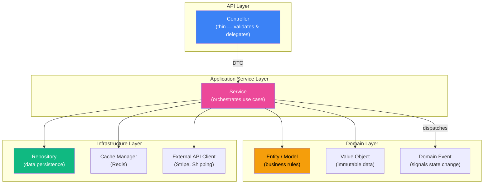

### 6.2 Service Rules

| Rule | Description |
|------|-------------|
| **Single Responsibility** | Each service handles one bounded context. `ProductService` manages products only. |
| **Interface-Driven** | Every service implements a contract (`ProductServiceInterface`). |
| **DTO In, DTO Out** | Services accept DTOs and return DTOs — never Eloquent models across module boundaries. |
| **Transaction Boundary** | The service is the transaction boundary. Database transactions wrap the entire use case, not individual repository calls. |
| **Event Emission** | After a successful state change, the service dispatches a domain event (e.g., `ProductCreated`). |
| **No HTTP Awareness** | Services have zero knowledge of HTTP requests, responses, or headers. |

### 6.3 Service Composition Pattern

For complex use cases that span multiple modules (e.g., checkout), we use a **Saga / Orchestrator Service**:

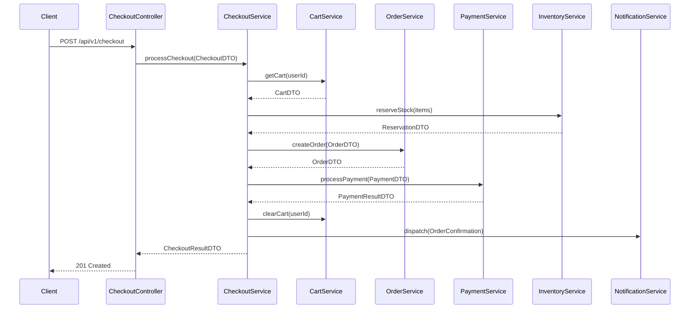

### 6.4 Why This Service Design?

* **Thin Controllers** — Controllers become trivially testable (just input validation + delegation). This is the Laravel best-practice recommended by the core team.
* **Orchestration vs. Choreography** — For critical flows (checkout, payment), we use orchestration (a central service coordinates) rather than pure choreography (events only) because order-of-operations matters and rollback must be explicit.
* **DTO boundary** — Prevents Eloquent model leakage across modules. If Module A returns a DTO, Module B has zero coupling to Module A's database schema.

---

## 7. Repository Pattern

### 7.1 Repository Layer Diagram

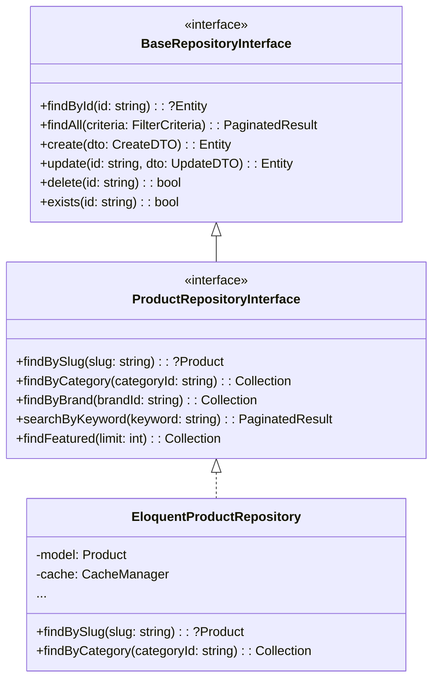

### 7.2 Repository Rules

| Rule | Rationale |
|------|-----------|
| **Interface in Domain layer** | The domain defines *what* data operations are needed. Infrastructure implements *how*. |
| **One Repository per Aggregate Root** | `OrderRepository` manages `Order` + `OrderItem` + `OrderStatusHistory`. There is no `OrderItemRepository`. |
| **No Query Scopes in Services** | All query logic lives in the repository. Services call named methods like `findBySlug()`, not raw `where()` chains. |
| **Cache-Through** | Repositories manage their own cache layer (read-through / write-invalidate via Redis). |
| **Return Domain Entities** | Repositories return hydrated domain entities, not Eloquent models (though internally they use Eloquent for persistence). |

### 7.3 Why the Repository Pattern?

* **Testability** — Swap `EloquentProductRepository` for `InMemoryProductRepository` in tests — zero database, sub-millisecond tests.
* **Query Optimisation Encapsulation** — Complex joins, eager loading, and caching are encapsulated in one place, not scattered across services.
* **Vendor Independence** — If the team decides to move the Product catalog to a NoSQL store (e.g., MongoDB or DynamoDB), only the repository implementation changes.

---

## 8. Dependency Injection Strategy

### 8.1 Binding Flow

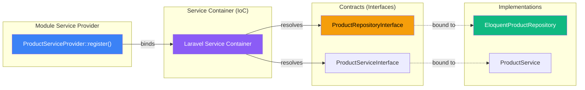

### 8.2 DI Rules

| Strategy | Implementation |
|----------|----------------|
| **Constructor Injection** | All dependencies are injected via constructor. No `app()` or `resolve()` calls inside business logic. |
| **Module Service Providers** | Each module has its own `ServiceProvider` that registers bindings. The root `AppServiceProvider` loads each module provider. |
| **Contextual Binding** | When the same interface has multiple implementations (e.g., `PaymentGatewayInterface` → `StripeGateway` or `PayPalGateway`), the active implementation is resolved via a factory or contextual binding based on configuration. |
| **Singleton vs. Transient** | Stateless services (repositories, services) are bound as singletons. Stateful objects (DTOs, entities) are never bound in the container. |
| **Environment-Aware Bindings** | Test environments bind in-memory fakes; production binds concrete implementations. |

### 8.3 Why This DI Strategy?

* **Decoupling** — No class ever instantiates its own dependencies. This is foundational to Clean Architecture.
* **Module Autonomy** — Each module controls its own bindings. Adding or removing a module is as simple as registering or deregistering its `ServiceProvider`.
* **Configuration-Driven Swapping** — Changing from Stripe to PayPal in production is a config change + binding swap, not a code change.

---

## 9. Event-Driven Architecture

### 9.1 Event Flow

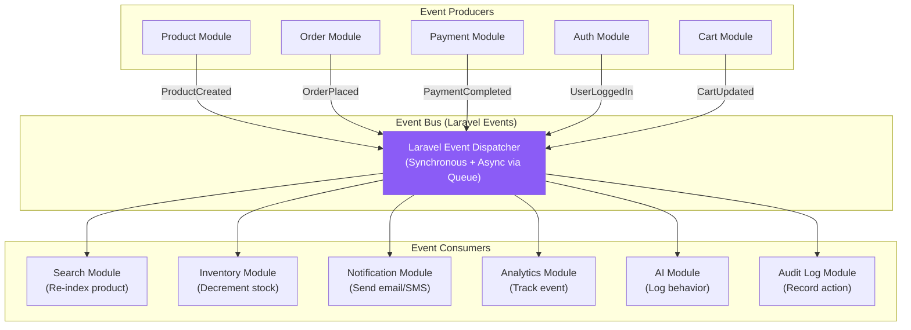

### 9.2 Event Catalog

| Event | Producer | Consumers | Async? |
|-------|----------|-----------|--------|
| `ProductCreated` | Product | Search (re-index), Analytics | Yes |
| `ProductUpdated` | Product | Search (re-index), Cache (invalidate) | Yes |
| `ProductDeleted` | Product | Search (remove), Inventory (archive) | Yes |
| `CategoryCreated` | Category | Search (rebuild facets) | Yes |
| `CartItemAdded` | Cart | AI (behavior tracking), Analytics | Yes |
| `CartItemRemoved` | Cart | AI (behavior tracking), Analytics | Yes |
| `OrderPlaced` | Order | Inventory (reserve), Payment (charge), Notification (confirm), Analytics, Audit | Mixed |
| `OrderCancelled` | Order | Inventory (release), Payment (refund), Notification | Mixed |
| `PaymentCompleted` | Payment | Order (update status), Notification (receipt), Audit | Sync |
| `PaymentFailed` | Payment | Order (mark failed), Notification (alert), Audit | Sync |
| `ShipmentCreated` | Shipping | Order (update tracking), Notification | Yes |
| `UserRegistered` | Auth | Notification (welcome), Analytics, AI (init profile) | Yes |
| `UserLoggedIn` | Auth | Analytics, Audit | Yes |
| `ReviewSubmitted` | Review | Product (update rating), Analytics, AI | Yes |
| `PageViewed` | Website | AI (behavior), Analytics | Yes |
| `ProductSearched` | Search | AI (behavior), Analytics | Yes |
| `CouponApplied` | Coupon | Analytics, Audit | Yes |

### 9.3 Event Categories

| Category | Behaviour | Use Case |
|----------|-----------|----------|
| **Domain Events** | Represent something that *happened* in the domain. Immutable. | `OrderPlaced`, `PaymentCompleted` |
| **Integration Events** | Cross-module communication via the event bus. | `ProductCreated` → triggers Search re-index |
| **Behavioral Events** | User interaction telemetry for the AI engine. | `PageViewed`, `CartItemAdded`, `ProductSearched` |

### 9.4 Why Event-Driven?

* **Module Decoupling** — The Order module doesn't know (or care) that the Notification module sends emails. It simply emits `OrderPlaced`.
* **AI Data Pipeline** — Every user interaction is an event. This creates a natural, real-time data stream for the neural-network recommendation engine.
* **Audit Trail** — Events are the source of truth for the Audit Log module. Every state change is captured.
* **Async Processing** — Heavy tasks (email sending, search indexing, AI feature computation) are pushed to queues, keeping API response times under 200ms.

---

## 10. Queue Architecture

### 10.1 Queue Topology

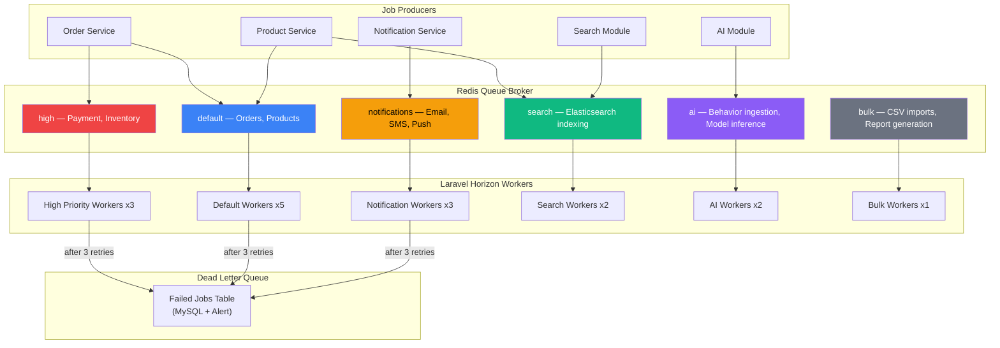

### 10.2 Queue Configuration

| Queue | Priority | Max Tries | Timeout | Backoff | Rationale |
|-------|----------|-----------|---------|---------|-----------|
| `high` | 1 | 3 | 30s | Exponential (1s, 5s, 30s) | Payment and inventory operations must not be delayed. |
| `default` | 2 | 3 | 60s | Exponential | Standard business operations. |
| `notifications` | 3 | 5 | 120s | Linear (30s) | Email delivery can retry more aggressively; failures are non-critical. |
| `search` | 4 | 3 | 300s | Exponential | Elasticsearch bulk indexing may take time. |
| `ai` | 4 | 2 | 600s | Exponential | Model inference can be slow; no blocking. |
| `bulk` | 5 | 1 | 3600s | None | CSV imports are one-shot; on failure, user re-uploads. |

### 10.3 Laravel Horizon Configuration

Horizon manages worker pools with auto-scaling based on queue depth:

| Supervisor | Queues | Min Workers | Max Workers | Balance Strategy |
|-----------|--------|-------------|-------------|------------------|
| `critical` | high | 2 | 5 | simple |
| `general` | default, notifications | 3 | 10 | auto |
| `background` | search, ai, bulk | 1 | 5 | auto |

### 10.4 Why This Queue Design?

* **Priority Isolation** — Payment-related jobs never compete with bulk CSV imports for worker time.
* **Horizon Auto-Scaling** — Workers scale up when queue depth increases (e.g., during flash sales) and scale down during low traffic.
* **Dead Letter Queue** — Failed jobs are persisted to MySQL for admin review. An alert is triggered to the Notification module.

---

## 11. Redis Strategy

### 11.1 Redis Usage Map

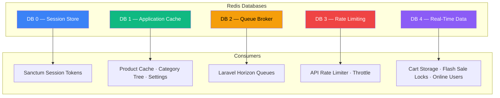

### 11.2 Caching Strategy

| Data | TTL | Invalidation Strategy | Rationale |
|------|-----|----------------------|-----------|
| **Product Detail** | 1 hour | Invalidate on `ProductUpdated` event | Products change infrequently; cache hit rate > 95%. |
| **Category Tree** | 24 hours | Invalidate on `CategoryUpdated` event | Tree structure changes rarely. |
| **Settings** | Until invalidation | Invalidate on `SettingUpdated` event | Global settings are read on every request. |
| **Cart** | 7 days | Overwrite on every cart operation | Carts must survive page refreshes but not forever. |
| **Search Results** | 5 minutes | Short TTL; no event invalidation | Search results change with new products; short TTL is sufficient. |
| **AI Recommendations** | 15 minutes | TTL-based | Recommendations update as behavior accumulates; 15 min is the acceptable staleness window. |
| **User Session** | 2 hours | Slide on activity | Security + UX balance. |
| **Rate Limit Counters** | 1 minute window | Auto-expire | Token bucket per IP / API key. |

### 11.3 Redis Data Structures Used

| Structure | Use Case |
|-----------|----------|
| **STRING** | Cache entries (product JSON, settings JSON). |
| **HASH** | Cart storage (`cart:{userId}` → field per item). |
| **SET** | Online users tracking, wish-list item IDs. |
| **SORTED SET** | Trending products (score = view count), rate limit sliding windows. |
| **LIST** | Queue job payloads (used by Horizon). |
| **STREAM** | Real-time event stream for AI behavior ingestion (Redis Streams). |

### 11.4 Why This Redis Strategy?

* **Database Separation** — Using separate Redis databases (0–4) prevents key collisions and allows independent flush operations (e.g., clear cache without destroying sessions).
* **Event-Driven Invalidation** — Cache is never stale because every domain event that changes data also invalidates the relevant cache keys.
* **Redis Streams for AI** — Provides a durable, ordered, consumer-group-friendly event log that the AI service polls — more reliable than fire-and-forget.

---

## 12. API Gateway Design

### 12.1 API Route Structure

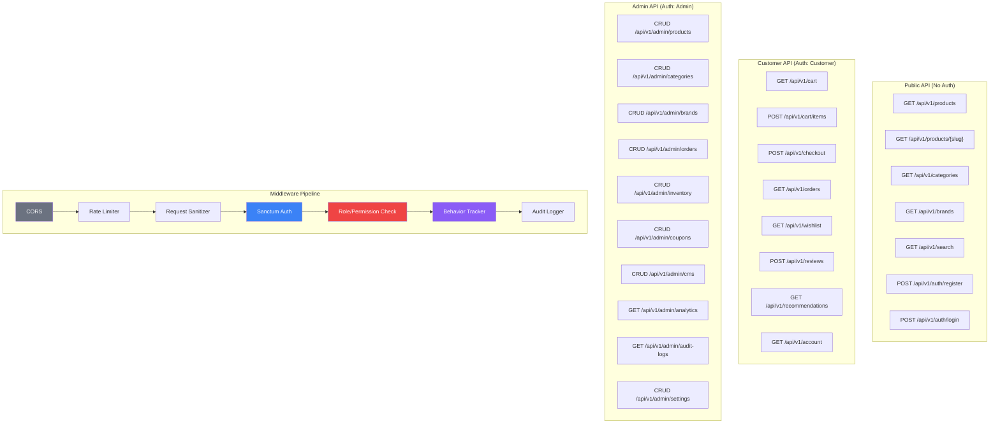

### 12.2 API Design Principles

| Principle | Implementation |
|-----------|----------------|
| **RESTful Naming** | Nouns for resources (`/products`), HTTP verbs for actions, plural names. |
| **Versioning** | Path-based: `/api/v1/…`. New major versions get `/api/v2/…` with a deprecation period on v1. |
| **Pagination** | Cursor-based for large collections (`?cursor=abc&per_page=20`). |
| **Filtering** | Query-string filters: `?category_id=5&min_price=10&sort=price_asc`. |
| **Response Envelope** | Every response follows: `{ success: bool, data: T, message: string, meta: { pagination } }`. |
| **Error Format** | `{ success: false, message: "...", errors: { field: ["message"] }, code: "VALIDATION_ERROR" }`. |
| **Rate Limiting** | 60 req/min for guests, 120 req/min for authenticated users, 1000 req/min for admin. Headers: `X-RateLimit-Remaining`. |
| **HATEOAS (Optional)** | Links to related resources in response `_links` for discoverability. |

### 12.3 Middleware Pipeline Order

1. **CORS** — Whitelist frontend domain.
2. **Rate Limiter** — Redis token bucket.
3. **Request Sanitizer** — Strip XSS, validate content-type.
4. **Sanctum Auth** — Resolve bearer token → user.
5. **Role/Permission Check** — Gate / Policy middleware.
6. **Behavior Tracker** — Emit `PageViewed`, `ProductViewed` etc. for AI.
7. **Audit Logger** — Log request metadata for admin audit trail.

### 12.4 Why This API Design?

* **BFF Pattern** — Next.js acts as a Backend-for-Frontend, proxying and aggregating API calls. This hides internal API structure from the browser and adds a server-side caching layer.
* **Middleware Pipeline** — Standardises cross-cutting concerns. Every request is rate-limited, authenticated, and tracked without repeating logic in controllers.
* **Cursor Pagination** — Unlike offset pagination, cursor-based pagination is stable under concurrent inserts (critical for product catalogs that change during flash sales).

---

## 13. Authentication Flow

### 13.1 Registration & Login Flow

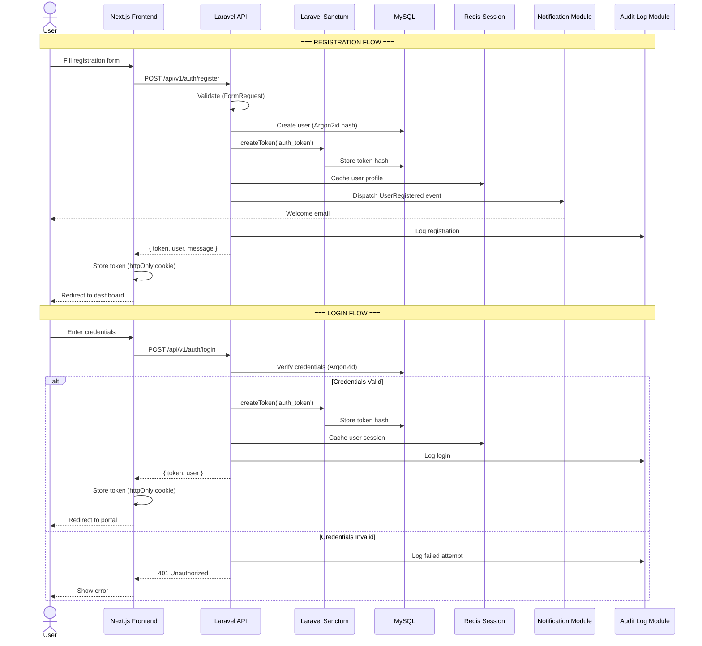

### 13.2 Token Lifecycle

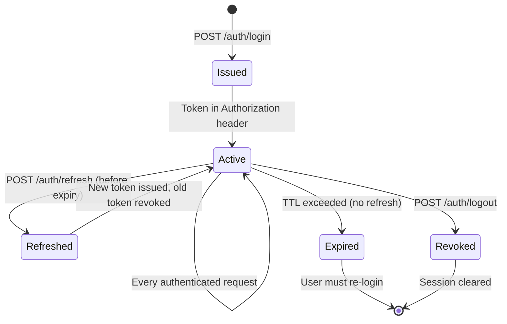

### 13.3 Token Architecture

| Token Type | Storage | TTL | Purpose |
|-----------|---------|-----|---------|
| **Access Token** | `httpOnly` cookie on frontend; `Authorization: Bearer` header for API calls | 60 minutes | Authenticates API requests. |
| **Refresh Token** | `httpOnly` cookie; separate from access token | 7 days | Silently re-issues access token without re-login. |
| **Personal Access Token** | Database (hashed) | Configurable / permanent | For API partner integrations. |

### 13.4 Why Sanctum?

* **SPA-Optimised** — Sanctum is designed for SPA authentication with cookie-based sessions or token-based APIs — both of which we use.
* **No External Dependencies** — Unlike Passport (OAuth2 server), Sanctum is lightweight with no JWK rotation or authorization server to manage.
* **Token Abilities** — Sanctum supports scoped token abilities (e.g., `order:read`, `product:write`), enabling fine-grained API partner access.

---

## 14. Authorization Flow

### 14.1 RBAC Model

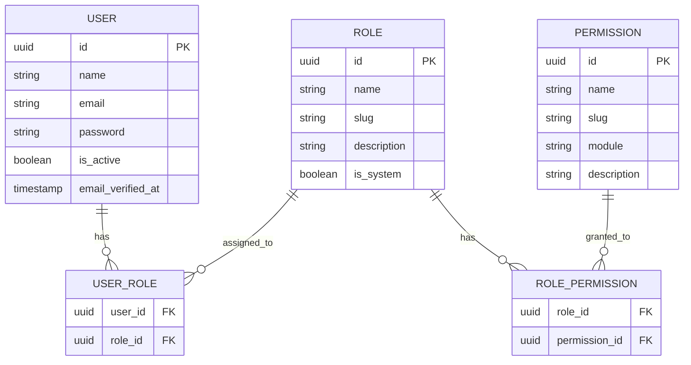

### 14.2 Permission Matrix

| Permission Slug | Module | Super Admin | Admin | Manager | Customer | Guest |
|----------------|--------|:-----------:|:-----:|:-------:|:--------:|:-----:|
| `product.view` | Product | ✅ | ✅ | ✅ | ✅ | ✅ |
| `product.create` | Product | ✅ | ✅ | ✅ | ❌ | ❌ |
| `product.update` | Product | ✅ | ✅ | ✅ | ❌ | ❌ |
| `product.delete` | Product | ✅ | ✅ | ❌ | ❌ | ❌ |
| `order.view` | Order | ✅ | ✅ | ✅ | Own only | ❌ |
| `order.manage` | Order | ✅ | ✅ | ✅ | ❌ | ❌ |
| `payment.refund` | Payment | ✅ | ✅ | ❌ | ❌ | ❌ |
| `analytics.view` | Analytics | ✅ | ✅ | ✅ | ❌ | ❌ |
| `settings.manage` | Settings | ✅ | ✅ | ❌ | ❌ | ❌ |
| `audit.view` | Audit | ✅ | ✅ | ❌ | ❌ | ❌ |
| `user.manage` | Auth | ✅ | ✅ | ❌ | ❌ | ❌ |
| `role.manage` | Auth | ✅ | ❌ | ❌ | ❌ | ❌ |

### 14.3 Authorization Decision Flow

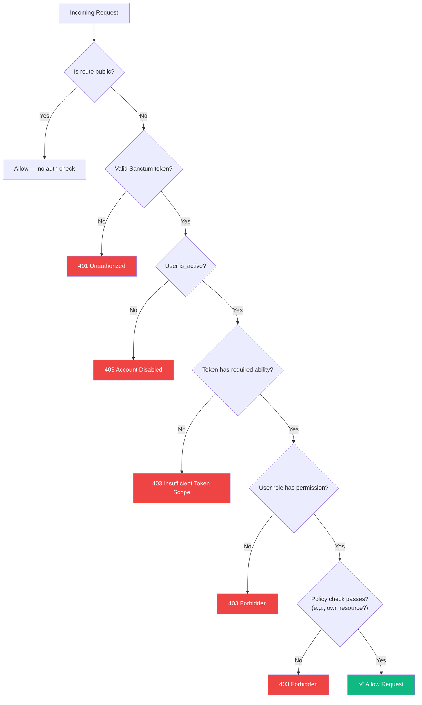

### 14.4 Why This Authorization Design?

* **Three-Layer Check** — Token scope → Role permission → Resource policy. This prevents privilege escalation at every level.
* **Policy Objects** — Laravel Policies encapsulate resource-level checks (e.g., "Can this user view *this specific* order?"). This is more maintainable than inline `if` statements.
* **Database-Stored Permissions** — Unlike hardcoded gates, database-stored permissions can be modified at runtime by a Super Admin without a deployment.

---

## 15. Communication Between Modules

### 15.1 Communication Patterns

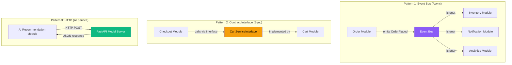

### 15.2 Communication Decision Matrix

| Scenario | Pattern | Rationale |
|----------|---------|-----------|
| Module A needs data from Module B **synchronously** and B is in the same codebase | **Contract/Interface** | Direct method call via DI. Fast. Type-safe. |
| Module A's state change should **notify** modules B, C, D | **Domain Event (async queue)** | Loose coupling. Producers don't know consumers. |
| Module A needs data from **external service** (AI, payment gateway) | **HTTP Client via Adapter** | External services are always behind an interface + HTTP adapter. |
| Module A needs **real-time** user interaction data sent to AI | **Redis Streams** | Durable, ordered, consumer-group support. |
| Cross-module **queries** (e.g., Admin dashboard aggregating data) | **Read-Model / CQRS Lite** | A shared read-model (database view or materialised query) avoids cross-module writes. |

### 15.3 Anti-Corruption Layer

When Module A consumes data from Module B, it does NOT use Module B's internal models. Instead:

```
Module B → exposes PublicDTO → Module A receives and maps to its own internal representation
```

This **Anti-Corruption Layer** ensures that changes to Module B's internal schema do not cascade into Module A.

### 15.4 Why These Patterns?

* **Events for Side Effects** — When an order is placed, the Order module should not know about inventory, notifications, or analytics. Events make this extensible — adding a new side effect means adding a new listener, zero changes to Order.
* **Contracts for Dependencies** — When Checkout *must* read the cart to function, an event is inappropriate (it's synchronous, not a side effect). A contract provides compile-time safety.
* **HTTP for AI** — The AI model server runs on Python/GPU infrastructure. It cannot share PHP process memory. HTTP is the only viable pattern.

---

## 16. AI Integration Flow

### 16.1 Neural Network Recommendation Architecture

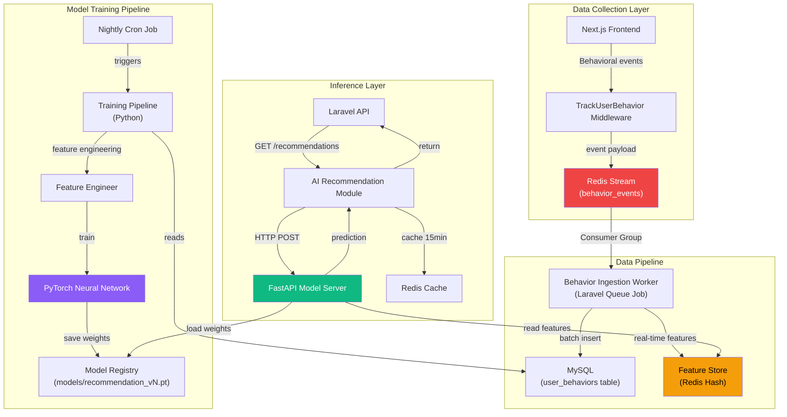

### 16.2 Behavioral Events Collected

| Event Type | Data Points | Weight |
|-----------|-------------|--------|
| `page_view` | product_id, category_id, timestamp, duration | Low |
| `product_view` | product_id, time_spent, scroll_depth | Medium |
| `search_query` | query_text, results_count, clicked_result | Medium |
| `add_to_cart` | product_id, quantity, source_page | High |
| `remove_from_cart` | product_id, reason (if provided) | Medium (negative) |
| `add_to_wishlist` | product_id | Medium |
| `purchase` | product_id, quantity, total_value | Highest |
| `review_submitted` | product_id, rating, sentiment | High |

### 16.3 Neural Network Model Architecture

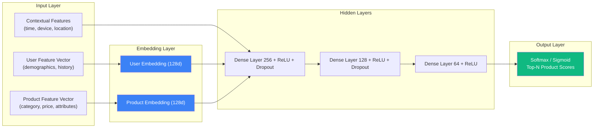

### 16.4 Recommendation Strategies

| Strategy | Algorithm | When Used |
|----------|-----------|-----------|
| **Personalised** | Neural collaborative filtering (NCF) with deep interaction layers | Logged-in user with ≥ 5 interactions |
| **Content-Based** | Product attribute similarity (cosine distance on embeddings) | New user with < 5 interactions |
| **Trending** | Time-decay weighted popularity (sorted set in Redis) | Home page fallback, guest users |
| **Cross-Sell** | Association rules (frequently bought together) | Cart page, checkout page |
| **Recently Viewed** | Session-based retrieval from Redis | Product detail page sidebar |

### 16.5 Why This AI Architecture?

* **Real-Time + Batch Hybrid** — Redis Streams provide real-time feature updates; nightly batch retraining ensures the model stays globally accurate.
* **Feature Store Pattern** — Pre-computed user and product features in Redis eliminate the need for on-the-fly feature engineering during inference, keeping latency under 100ms.
* **Decoupled Model Server** — The FastAPI server can be deployed on GPU nodes independently of the Laravel API. Model updates (weight swaps) require zero downtime for the main application.
* **HND Alignment** — This directly satisfies "Real-Time User Behavior Tracking and Neural Network-Based Personalized Product Recommendation System."

---

## 17. Sequence Diagrams

### 17.1 Product Purchase (End-to-End)

```mermaid
sequenceDiagram
    actor Customer
    participant FE as Next.js
    participant API as Laravel API
    participant Cart as Cart Module
    participant Checkout as Checkout Module
    participant Inventory as Inventory Module
    participant Order as Order Module
    participant Payment as Payment Module
    participant Stripe as Stripe API
    participant Shipping as Shipping Module
    participant Notif as Notification Module
    participant AI as AI Module
    participant Audit as Audit Log

    Customer->>FE: Add product to cart
    FE->>API: POST /api/v1/cart/items
    API->>Cart: addItem(CartItemDTO)
    Cart->>Cart: Validate stock availability
    Cart-->>API: CartDTO
    API-->>FE: Updated cart

    Note over Customer, Audit: Customer proceeds to checkout

    Customer->>FE: Click "Checkout"
    FE->>API: POST /api/v1/checkout
    API->>Checkout: processCheckout(CheckoutDTO)
    Checkout->>Cart: getCart(userId)
    Cart-->>Checkout: CartDTO

    Checkout->>Inventory: reserveStock(items)
    Inventory->>Inventory: Atomic decrement with Redis lock
    Inventory-->>Checkout: ReservationConfirmation

    Checkout->>Order: createOrder(OrderDTO)
    Order->>Order: Generate order number
    Order-->>Checkout: OrderDTO (status: pending_payment)

    Checkout->>Payment: processPayment(PaymentDTO)
    Payment->>Stripe: Create PaymentIntent
    Stripe-->>Payment: PaymentIntent confirmed
    Payment-->>Checkout: PaymentResultDTO (success)

    Checkout->>Order: updateStatus(order_id, "paid")
    Checkout->>Cart: clearCart(userId)
    Checkout->>Shipping: calculateShipping(order)
    Shipping-->>Checkout: ShippingDTO

    Checkout-->>API: CheckoutResultDTO
    API-->>FE: Order confirmation

    Note over Customer, Audit: Async events fire

    Order->>Notif: emit OrderPlaced
    Notif-->>Customer: Order confirmation email
    Order->>AI: emit PurchaseEvent
    Order->>Audit: Log order creation
    Payment->>Audit: Log payment
```

### 17.2 AI Recommendation Request

```mermaid
sequenceDiagram
    actor User
    participant FE as Next.js
    participant API as Laravel API
    participant AIModule as AI Recommendation Module
    participant Redis as Redis Cache
    participant FastAPI as FastAPI Model Server
    participant FeatureStore as Feature Store (Redis)

    User->>FE: Visit product page
    FE->>API: GET /api/v1/recommendations?product_id=123
    API->>AIModule: getRecommendations(userId, productId)

    AIModule->>Redis: Check cache (key: rec:{userId}:{productId})
    alt Cache Hit
        Redis-->>AIModule: Cached recommendations
    else Cache Miss
        AIModule->>FastAPI: POST /predict { user_id, product_id, context }
        FastAPI->>FeatureStore: Get user features
        FeatureStore-->>FastAPI: User vector
        FastAPI->>FeatureStore: Get product features
        FeatureStore-->>FastAPI: Product vector
        FastAPI->>FastAPI: Neural network inference
        FastAPI-->>AIModule: Top-10 product IDs with scores
        AIModule->>Redis: Cache result (TTL: 15 min)
    end

    AIModule-->>API: RecommendationResponseDTO
    API-->>FE: { recommendations: [...] }
    FE-->>User: Display "Recommended For You"
```

### 17.3 Admin Product Management

```mermaid
sequenceDiagram
    actor Admin
    participant FE as Admin Dashboard
    participant API as Laravel API
    participant Auth as Auth Middleware
    participant Product as Product Module
    participant Search as Search Module
    participant Cache as Redis Cache
    participant Audit as Audit Log

    Admin->>FE: Fill create product form
    FE->>API: POST /api/v1/admin/products
    API->>Auth: Verify token + permission (product.create)
    Auth-->>API: Authorized

    API->>Product: createProduct(CreateProductDTO)
    Product->>Product: Validate business rules
    Product->>Product: Persist to MySQL
    Product->>Product: Dispatch ProductCreated event

    Product-->>API: ProductResponseDTO
    API-->>FE: 201 Created

    Note over Admin, Audit: Async event listeners

    Product->>Search: Listener: Index product in Elasticsearch
    Product->>Cache: Listener: Invalidate product cache
    Product->>Audit: Listener: Log admin action
```

---

## 18. Component Diagrams

### 18.1 Backend Component Architecture

```mermaid
graph TB
    subgraph "HTTP Layer"
        NGINX["Nginx / Load Balancer"]
    end

    subgraph "Application Layer"
        subgraph "Laravel Application"
            ROUTER["Route Dispatcher"]
            MW["Middleware Stack"]
            
            subgraph "Module Controllers"
                PC["Product Controller"]
                OC["Order Controller"]
                CC["Cart Controller"]
                AUC["Auth Controller"]
                AC["Admin Controllers"]
            end

            subgraph "Application Services"
                PS["Product Service"]
                OS["Order Service"]
                CS["Cart Service"]
                CKS["Checkout Service"]
                PMS["Payment Service"]
                INS["Inventory Service"]
                SHS["Shipping Service"]
                AIS["AI Recommendation Service"]
                NTS["Notification Service"]
                SS["Search Service"]
                ALS["Audit Log Service"]
            end

            subgraph "Domain Layer"
                DM["Domain Models"]
                DE["Domain Events"]
                DVO["Value Objects"]
                DP["Policies"]
            end

            subgraph "Infrastructure"
                REPO["Eloquent Repositories"]
                CACHE["Redis Cache Manager"]
                QUEUE["Queue Job Dispatcher"]
                HTTP_C["HTTP Clients (Stripe, Shipping, AI)"]
                ES["Elasticsearch Client"]
            end
        end
    end

    subgraph "Data Layer"
        MYSQL["MySQL 8 (Primary)"]
        MYSQL_R["MySQL 8 (Read Replica)"]
        REDIS_D["Redis Cluster"]
        ES_D["Elasticsearch Cluster"]
    end

    subgraph "External Services"
        STRIPE["Stripe"]
        SHIP_API["Shipping APIs"]
        EMAIL["SendGrid"]
        SMS["Twilio"]
        AI_SVC["FastAPI AI Server"]
    end

    NGINX --> ROUTER
    ROUTER --> MW
    MW --> PC & OC & CC & AUC & AC

    PC --> PS
    OC --> OS
    CC --> CS

    PS & OS & CS & CKS --> REPO
    PS & OS --> DE
    AIS --> HTTP_C
    PMS --> HTTP_C
    NTS --> QUEUE
    SS --> ES

    REPO --> MYSQL & MYSQL_R
    CACHE --> REDIS_D
    QUEUE --> REDIS_D
    ES --> ES_D
    HTTP_C --> STRIPE & SHIP_API & AI_SVC

    style NGINX fill:#6b7280,color:#fff
    style MYSQL fill:#3b82f6,color:#fff
    style REDIS_D fill:#ef4444,color:#fff
    style ES_D fill:#10b981,color:#fff
    style AI_SVC fill:#8b5cf6,color:#fff
```

### 18.2 Frontend Component Architecture

```mermaid
graph TD
    subgraph "Next.js Application"
        subgraph "App Router"
            STORE["(store) — Public Pages"]
            PORTAL["(portal) — Customer Portal"]
            ADMIN["(admin) — Admin Dashboard"]
            AUTHP["(auth) — Login/Register"]
        end

        subgraph "Module Layer"
            PM["Product Module"]
            CM["Cart Module"]
            OM["Order Module"]
            AM["Auth Module"]
            RM["Recommendation Module"]
            SM["Search Module"]
        end

        subgraph "State Management"
            ZS["Zustand Stores<br/>(Cart, Auth, UI)"]
            TQ["TanStack Query<br/>(Server State Cache)"]
        end

        subgraph "Shared UI"
            SCN["Shadcn UI Components"]
            LAYOUT["Layout Components"]
            FORMS["Form Components"]
        end

        subgraph "API Layer"
            CLIENT["API Client (Axios)"]
            HOOKS["Query Hooks"]
            MUTS["Mutation Hooks"]
        end
    end

    subgraph "Backend"
        BE["Laravel REST API"]
    end

    STORE --> PM & CM & SM & RM
    PORTAL --> OM & PM
    ADMIN --> PM & OM & CM

    PM & CM & OM --> HOOKS & MUTS
    HOOKS & MUTS --> CLIENT
    CLIENT --> BE

    PM & CM --> ZS
    PM & OM --> TQ

    PM & CM & OM --> SCN

    style ZS fill:#f59e0b,color:#000
    style TQ fill:#3b82f6,color:#fff
    style SCN fill:#8b5cf6,color:#fff
```

---

## 19. Deployment Diagram

### 19.1 Production Infrastructure

```mermaid
graph TB
    subgraph "Internet"
        USERS["Users / Browsers"]
        PARTNERS["API Partners"]
    end

    subgraph "Edge Layer"
        CDN["CloudFront CDN<br/>(Static Assets, Images)"]
        WAF["AWS WAF<br/>(DDoS, OWASP Rules)"]
    end

    subgraph "Load Balancing"
        ALB["Application Load Balancer<br/>(TLS Termination, Health Checks)"]
    end

    subgraph "Compute — Kubernetes (EKS)"
        subgraph "Frontend Pods"
            FE1["Next.js Pod 1"]
            FE2["Next.js Pod 2"]
            FE3["Next.js Pod N"]
        end

        subgraph "Backend Pods"
            BE1["Laravel API Pod 1"]
            BE2["Laravel API Pod 2"]
            BE3["Laravel API Pod N"]
        end

        subgraph "Worker Pods"
            WK1["Horizon Worker — Critical"]
            WK2["Horizon Worker — General"]
            WK3["Horizon Worker — Background"]
        end

        subgraph "AI Pods (GPU Node Pool)"
            AI1["FastAPI + PyTorch Pod 1"]
            AI2["FastAPI + PyTorch Pod 2"]
        end

        subgraph "Scheduler"
            CRON["Laravel Scheduler Pod"]
        end
    end

    subgraph "Data Layer"
        subgraph "MySQL Cluster (RDS)"
            DB_P["Primary (Write)"]
            DB_R1["Read Replica 1"]
            DB_R2["Read Replica 2"]
        end

        subgraph "Redis Cluster (ElastiCache)"
            R_P["Redis Primary"]
            R_R["Redis Replica"]
        end

        subgraph "Elasticsearch (OpenSearch)"
            ES1["ES Node 1"]
            ES2["ES Node 2"]
            ES3["ES Node 3"]
        end

        S3["S3 Bucket<br/>(Product Images, Exports)"]
    end

    subgraph "Observability"
        PROM["Prometheus"]
        GRAF["Grafana Dashboards"]
        ELK["ELK Stack<br/>(Logs)"]
        OTEL["OpenTelemetry<br/>(Tracing)"]
    end

    USERS --> CDN --> ALB
    USERS --> WAF --> ALB
    PARTNERS --> WAF --> ALB

    ALB --> FE1 & FE2 & FE3
    ALB --> BE1 & BE2 & BE3

    FE1 & FE2 --> BE1 & BE2 & BE3

    BE1 & BE2 & BE3 --> DB_P & DB_R1
    BE1 & BE2 & BE3 --> R_P
    BE1 & BE2 & BE3 --> ES1

    WK1 & WK2 & WK3 --> R_P
    WK1 & WK2 & WK3 --> DB_P

    BE1 & BE2 --> AI1 & AI2
    AI1 & AI2 --> R_P

    BE1 & BE2 --> S3

    BE1 --> OTEL
    BE1 --> ELK
    PROM --> GRAF

    style CDN fill:#f59e0b,color:#000
    style ALB fill:#3b82f6,color:#fff
    style DB_P fill:#ef4444,color:#fff
    style R_P fill:#ef4444,color:#fff
    style AI1 fill:#8b5cf6,color:#fff
    style S3 fill:#10b981,color:#fff
```

### 19.2 Environment Topology

| Environment | Purpose | Infrastructure |
|-------------|---------|---------------|
| **Local Dev** | Developer workstation | Docker Compose (all services) |
| **CI/CD** | Automated testing | GitHub Actions → Docker containers |
| **Staging** | Pre-production validation | Kubernetes (scaled-down, same architecture) |
| **Production** | Live traffic | Kubernetes (full scale, multi-AZ) |

### 19.3 Why This Deployment Architecture?

* **Kubernetes** — Provides auto-scaling, self-healing, rolling deployments, and service discovery. This is the industry standard for enterprise applications.
* **Separate GPU Node Pool** — AI pods run on GPU-optimised instances (`g5.xlarge`), isolated from the CPU-bound Laravel and Next.js pods.
* **Multi-AZ Database** — MySQL RDS Multi-AZ ensures automatic failover with zero data loss.
* **CDN for Static Assets** — Product images and Next.js static bundles are served from CloudFront edge locations, reducing latency to under 50ms globally.

---

## 20. High-Level Architecture Diagram

### 20.1 Complete System Overview

```mermaid
graph TB
    subgraph "Clients"
        BROWSER["Customer Browser<br/>(Next.js SPA)"]
        MOBILE["Mobile App<br/>(Future)"]
        PARTNER["API Partner<br/>(REST Client)"]
    end

    subgraph "Edge"
        CDN["CDN"]
        LB["Load Balancer + WAF"]
    end

    subgraph "Presentation Tier"
        NEXTJS["Next.js 16<br/>React 19 + TypeScript<br/>Shadcn UI + Tailwind v4<br/>TanStack Query + Zustand"]
    end

    subgraph "API Tier — Laravel 12 Modular Monolith"
        subgraph "Gateway Layer"
            CORS["CORS"]
            RATE["Rate Limiter"]
            SANC["Sanctum Auth"]
            TRACK["Behavior Tracker"]
        end

        subgraph "Customer-Facing Modules"
            M_WEB["Website"]
            M_PORT["Customer Portal"]
            M_CART["Cart"]
            M_CHECK["Checkout"]
            M_WISH["Wishlist"]
            M_REV["Review"]
        end

        subgraph "Commerce Core Modules"
            M_PROD["Product"]
            M_CAT["Category"]
            M_BRAND["Brand"]
            M_INV["Inventory"]
            M_ORD["Order"]
            M_PAY["Payment"]
            M_SHIP["Shipping"]
            M_COUP["Coupon"]
        end

        subgraph "Intelligence Modules"
            M_AI["AI Recommendation"]
            M_SEARCH["Search"]
            M_ANALYTICS["Analytics"]
        end

        subgraph "Platform Modules"
            M_CMS["CMS"]
            M_NOTIF["Notification"]
            M_SET["Settings"]
            M_AUTH["Authentication"]
            M_AUDIT["Audit Log"]
            M_API["REST API"]
            M_ADMIN["Admin Dashboard"]
        end

        subgraph "Core Infrastructure"
            EVT_BUS["Event Bus"]
            QUEUE_D["Queue Dispatcher"]
            CACHE_M["Cache Manager"]
        end
    end

    subgraph "Worker Tier"
        HOR["Laravel Horizon"]
        W_CRIT["Critical Workers"]
        W_GEN["General Workers"]
        W_BG["Background Workers"]
    end

    subgraph "AI Tier"
        FASTAPI["FastAPI Model Server"]
        PYTORCH["PyTorch Neural Network"]
        FSTORE["Feature Store"]
        TRAIN["Training Pipeline"]
    end

    subgraph "Data Tier"
        MYSQL["MySQL 8 Cluster"]
        REDIS["Redis Cluster"]
        ELASTIC["Elasticsearch"]
        S3["Object Storage (S3)"]
    end

    subgraph "External Services"
        STRIPE["Stripe / PayPal"]
        CARRIERS["UPS / FedEx / DHL"]
        SENDGRID["SendGrid"]
        TWILIO["Twilio"]
    end

    subgraph "Observability"
        LOGS["ELK Stack"]
        METRICS["Prometheus + Grafana"]
        TRACES["OpenTelemetry"]
    end

    BROWSER --> CDN --> LB
    MOBILE --> LB
    PARTNER --> LB
    LB --> NEXTJS
    NEXTJS -->|"REST API"| CORS

    CORS --> RATE --> SANC --> TRACK

    TRACK --> M_WEB & M_PORT & M_CART & M_CHECK
    TRACK --> M_PROD & M_CAT & M_BRAND
    TRACK --> M_ORD & M_PAY & M_SHIP
    TRACK --> M_AI & M_SEARCH & M_ANALYTICS
    TRACK --> M_CMS & M_NOTIF & M_AUTH & M_ADMIN

    M_PROD & M_ORD & M_PAY --> EVT_BUS
    EVT_BUS --> M_INV & M_NOTIF & M_ANALYTICS & M_AUDIT & M_AI
    EVT_BUS --> QUEUE_D

    QUEUE_D --> HOR
    HOR --> W_CRIT & W_GEN & W_BG

    M_AI -->|"HTTP"| FASTAPI
    FASTAPI --> PYTORCH
    FASTAPI --> FSTORE
    TRAIN --> PYTORCH

    M_PROD & M_ORD & M_AUTH --> MYSQL
    M_CART & M_AI & M_SEARCH --> REDIS
    CACHE_M --> REDIS
    QUEUE_D --> REDIS
    FSTORE --> REDIS

    M_SEARCH --> ELASTIC
    M_PROD -->|"images"| S3

    M_PAY --> STRIPE
    M_SHIP --> CARRIERS
    M_NOTIF --> SENDGRID & TWILIO

    M_API --> LOGS & METRICS & TRACES

    style NEXTJS fill:#3b82f6,color:#fff
    style EVT_BUS fill:#8b5cf6,color:#fff
    style FASTAPI fill:#10b981,color:#fff
    style MYSQL fill:#ef4444,color:#fff
    style REDIS fill:#f59e0b,color:#000
    style ELASTIC fill:#3b82f6,color:#fff
```

---

## Architecture Decision Summary

| Decision | Choice | Why |
|----------|--------|-----|
| Modular Monolith over Microservices | Module-per-folder in Laravel | Shopify-proven pattern; avoids distributed complexity while maintaining module isolation. Extractable later. |
| Clean Architecture | Dependencies point inward | Framework changes (Laravel → Symfony) affect only outer rings. Domain logic is immortal. |
| Repository Pattern | Interface + Eloquent implementation | Testability (in-memory fakes), query encapsulation, vendor independence. |
| Event-Driven Communication | Laravel Events + Queue | Loose coupling between modules. Natural AI data pipeline. Audit trail for free. |
| Redis for everything stateful | Sessions, cache, queues, feature store, rate limiting | Single operational dependency for all ephemeral state. Battle-tested at scale. |
| Sanctum over Passport | Token-based auth | Lightweight, SPA-optimised, no OAuth server overhead. Scoped abilities for partner APIs. |
| FastAPI for AI | Separate Python service | GPU deployment, PyTorch native, decoupled model lifecycle. |
| Cursor Pagination | Over offset pagination | Stable under concurrent writes (flash sales), O(1) vs O(n) for deep pages. |
| DTO boundaries | No Eloquent models cross module borders | Prevents schema coupling. Module A's migration never breaks Module B. |
| Terraform + Kubernetes | IaC + container orchestration | Reproducible environments, auto-scaling, self-healing. Industry standard. |

---

**End of Enterprise Architecture Document — Version 2.0**

*This document should be read alongside the Software Requirements Specification (SRS v1.0) and serves as the technical blueprint for all development, testing, and deployment activities.*
